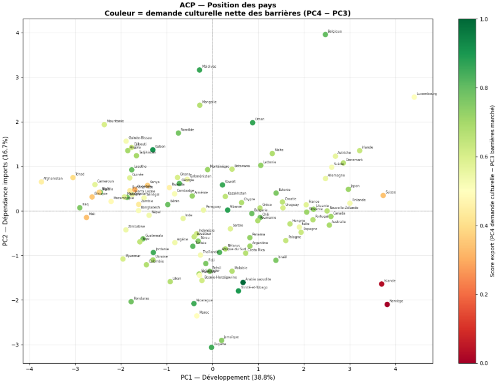
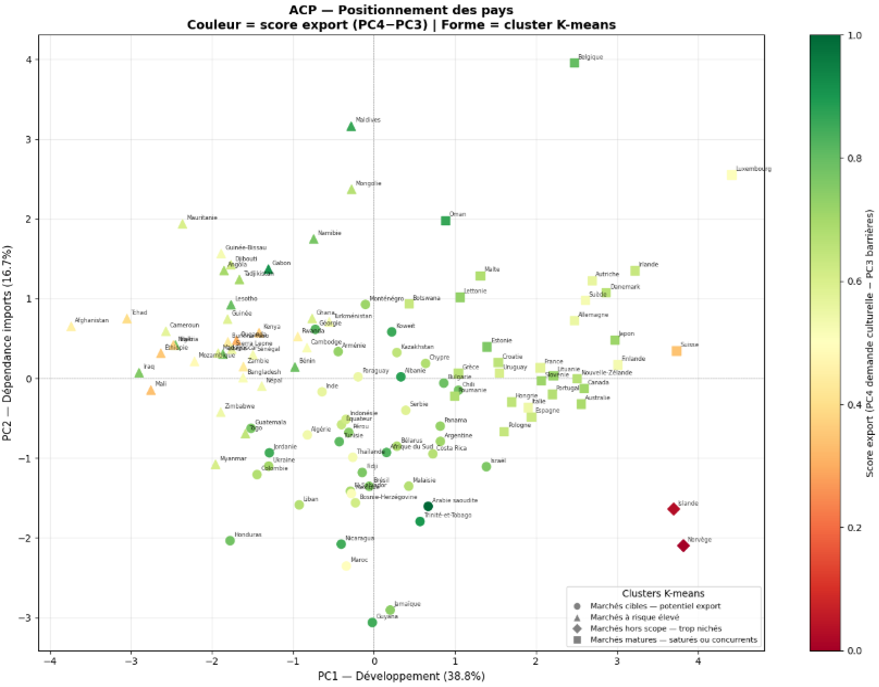
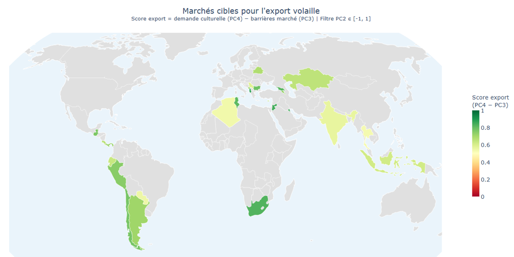

# Etude-de-marché-identifier-les-pays-cibles-pour-l-export-de-volaille

Python · ACP · Clustering · Formation

Sélection de marchés d'exportation pour une entreprise avicole à partir d'une analyse PESTEL, d'une analyse en composantes principales et d'une segmentation de 100 pays.

## Contexte

Ce projet a été réalisé dans le cadre de ma formation de Data Analyst chez OpenClassrooms. Dans un scénario fictif situé en 2017, l'entreprise « La Poule qui Chante » cherche à se développer à l'international et me demande de repérer les pays les plus prometteurs pour l'exportation de volaille.

## Démarche

1. **Cadrage par une analyse PESTEL**
   - Pour chaque dimension (politique, économique, socioculturelle, technologique, environnementale, légale), choix de variables répondant à une question business précise et classées comme opportunité, risque, barrière, contrainte ou filtre
   - 8 variables retenues : stabilité politique, droits de douane sur le poulet frais, PIB par habitant, dépendance aux importations de volaille, ancrage culturel de la consommation de volaille, croissance démographique, performance logistique, risque environnemental
   - 1 filtre qualitatif : existence d'un accord commercial avec l'Union européenne

2. **Collecte et préparation**
   - 7 sources internationales : FAO, Banque mondiale (gouvernance, démographie, logistique), FMI, OMC (accords commerciaux), WITS (droits de douane) et INFORM (risque environnemental)
   - Construction de deux indicateurs sur mesure : la dépendance aux importations (importations / consommation de volaille) et l'ancrage culturel (kcal de volaille / kcal de protéines animales)
   - Fusion systématique avec le jeu de données le plus volumineux comme table de gauche, pour limiter les pertes
   - Échantillon de 100 pays, avec imputation des valeurs manquantes par la médiane pour deux variables (droits de douane, dépendance aux importations)

3. **Analyse en composantes principales (ACP)**
   - Normalisation par z-score, 4 axes conservés pour 80 % de la variance
   - Interprétation business de chaque axe : développement / vulnérabilité (PC1), dépendance aux imports vs consommation ancrée (PC2), marchés émergents protégés par des tarifs (PC3), demande culturelle structurelle (PC4)
   - Construction d'un **score d'opportunité nette = PC4 − PC3** (demande structurelle moins barrières de marché)

4. **Segmentation des marchés**
   - Classification ascendante hiérarchique (méthode de Ward) puis K-moyennes, comparées entre elles
   - Choix de k = 4 par le score de silhouette, en cohérence avec l'objectif business

5. **Sélection finale et vérification**
   - Conservation du cluster « marchés cibles » avec un score PC2 compris entre −1 et 1
   - Vérification des accords commerciaux avec l'UE dans la base de l'OMC

## Résultats

- **26 marchés cibles** retenus sur 100 pays, parmi lesquels l'Albanie, le Koweït, la Jordanie, la Géorgie et l'Afrique du Sud, qui obtiennent les meilleurs scores d'opportunité nette
- **10 d'entre eux ont un accord commercial en vigueur avec l'UE** : Albanie, Pérou, Algérie, Serbie, Équateur, Monténégro, Jordanie, Tunisie, Afrique du Sud, Géorgie. Ce sont les candidats prioritaires.
- Les marchés retenus limitent l'exposition aux risques politiques et naturels, évitent les marchés matures et très concurrentiels, et associent une consommation de volaille élevée à une dépendance maîtrisée aux importations
- Les K-moyennes donnent des groupes plus homogènes que la CAH, qui laisse davantage de pays en position intermédiaire

## Aller plus loin : analyses complémentaires

- **Cadre PESTEL formalisé** : chaque variable est reliée à une question business et à un rôle (opportunité, risque, barrière, contrainte, filtre) avant toute modélisation
- **Score d'opportunité nette (PC4 − PC3)** : un indicateur synthétique construit à partir de l'ACP, pour lire attractivité et barrières sur une seule échelle
- **Comparaison de deux méthodes de clustering** (CAH de Ward et K-moyennes), avec test du nombre de clusters par le score de silhouette
- **Filtre de sélection sur PC2** pour écarter les marchés saturés par leur production locale (comme le Brésil) et ceux où la volaille est peu ancrée dans les habitudes alimentaires
- **Vérification des accords UE** avec une fonction qui exclut les faux positifs (par exemple, les accords concernant les pays et territoires d'outre-mer)
- **Visualisations avancées** : biplot de l'ACP coloré par le score d'opportunité, carte choroplèthe des marchés cibles

## Réalisations

**Sélection finale des marchés cibles (Python)**

```python
df_cibles = df_carte[
    (df_carte['cluster'] == 0) &        # cluster « marchés cibles »
    (df_carte['PC2'] >= -1) &
    (df_carte['PC2'] <= 1)              # demande réelle et besoin d'imports
].copy()

df_cibles = df_cibles.sort_values('score_export', ascending=False)
```


*Biplot : score d'opportunité nette sur le plan PC1 / PC2*


*Segmentation des marchés par K-moyennes*


*Marchés cibles pour l'export de volaille*

## Limites

- Les valeurs manquantes imputées par la médiane réduisent la variabilité des données
- Plusieurs variables ne correspondent pas à 2017 : droits de douane de 2022 et indice logistique de 2016, faute de données pour l'année de référence
- Le score de silhouette le plus élevé correspond à k = 2 ; le choix de k = 4 privilégie la lisibilité business

## Stack

`Python` · `pandas` · `scikit-learn` · `scipy` · `plotly` · `seaborn` · `Jupyter`

[Voir le projet complet sur GitHub →]()
[Retour à la liste de projets →]()
